# Using klayout-magic-pcells

This guide shows how to install the package in KLayout, place and edit
devices, check a layout with Magic's DRC, extraction and LVS from
KLayout's Magic menu, and use the package's command line and test harness.
It is for someone who already has KLayout and Magic with at least one of
the supported PDKs (sky130A, gf180mcuD, ihp-sg13g2 or ihp-sg13cmos5l), and
netgen for LVS, for example in the
[IIC-OSIC-TOOLS](https://github.com/iic-jku/IIC-OSIC-TOOLS) Docker image,
whose own documentation says how to start it with a desktop.
[README.md](README.md) describes the package in full; this guide links to
it where the details are.

The transcripts below were run on 2026-11-24 with version 0.6.0, and
those whose output version 0.6.2 changes were run again with 0.6.2 on the
same day. They and the screenshots come from the image
`hpretl/iic-osic-tools@sha256:3c371645b19c6f6564dc8c7b21e39ad1c1833d274fe5b85639afe1ba9d7987e7`
(KLayout 0.30.11, Magic 8.3.681, netgen 1.5.323, sky130A from open_pdks
026824c7), with the image's `PDK` variable set to `sky130A`. The repository
was mounted into the container at `/foss/designs/klayout-magic-pcells`, as
`tools/screenshots/take.sh` mounts it, except where a section says
otherwise. In your own setup, use the folder you cloned the repository into
wherever this guide writes that path. The screenshots are of KLayout's GUI
under Xvfb, driven by a macro (see [How the screenshots were
made](#how-the-screenshots-were-made)). They use a white canvas; the
image's own `klayoutrc` sets a black one.

## Contents

1. [Install the package](#install-the-package)
2. [Choose the PDKs](#choose-the-pdks)
3. [Find the libraries](#find-the-libraries)
4. [Place a device](#place-a-device)
5. [Edit a placed device](#edit-a-placed-device)
6. [Via, contact and well PCells](#via-contact-and-well-pcells)
7. [Stamps on a generated cell](#stamps-on-a-generated-cell)
8. [Save and reopen](#save-and-reopen)
9. [The Magic menu](#the-magic-menu)
10. [Magic DRC](#magic-drc)
11. [Check the visible area](#check-the-visible-area)
12. [LVS with netgen](#lvs-with-netgen)
13. [Extract with Magic](#extract-with-magic)
14. [Check generated layers](#check-generated-layers)
15. [Check ports](#check-ports)
16. [Rule differences](#rule-differences)
17. [Settings](#settings)
18. [The PDK a check uses](#the-pdk-a-check-uses)
19. [The command line](#the-command-line)
20. [The parity harness](#the-parity-harness)
21. [How the screenshots were made](#how-the-screenshots-were-made)

## Install the package

The repository is a KLayout Salt package. Clone it to a folder of your own
(`git clone https://github.com/uoftasic/klayout-magic-pcells.git`), then
link that folder into the `salt` folder of your KLayout home, `~/.klayout`.
Outside the image, make the `salt` folder first if it doesn't exist
(`mkdir -p ~/.klayout/salt`). In the image, the home directory is
`/headless` and the `salt` folder exists; this is the link that the run for
this guide made:

```sh
ln -s /foss/designs/klayout-magic-pcells ~/.klayout/salt/klayout-magic-pcells
```

Start KLayout, or restart it if it is running. At start-up it runs the
package's autorun macro, which starts one Magic process for each PDK it
selects (by default every installed one; see [Choose the
PDKs](#choose-the-pdks)) and registers a library for it, and adds the
[Magic menu](#the-magic-menu). Tools > Manage Packages then lists the
package under Current Packages:

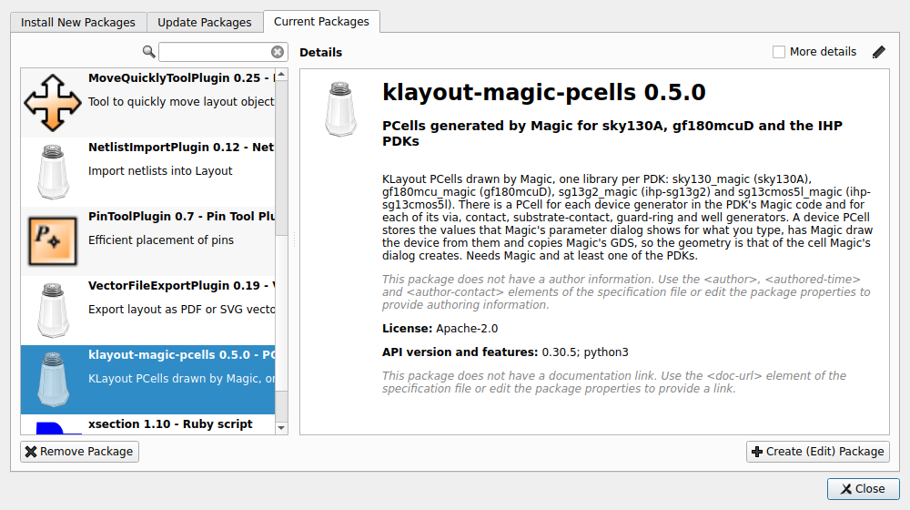

The screenshot was taken at version 0.5.0. The list shows the version that
the package's `grain.xml` gives, which is 0.6.2 for this version.

For this guide the package was installed with the link above and checked
only in this list. Installing through the Package Manager's Install tab, or
with `klayout -y`, has not been tried.

`doctor` checks the setup from a shell. It prints each setting and where it
came from, then starts Magic for each selected PDK, compares Magic's device
defaults with the manifest the package ships, and times one generation. It
needs the package's `python` folder on `PYTHONPATH`, as do all the
`python3 -m klayout_magic_pcells` commands in this guide:

```
$ cd /foss/designs/klayout-magic-pcells
$ export PYTHONPATH=$PWD/python
$ python3 -m klayout_magic_pcells doctor --pdk sky130A
configuration (config file: none)
  magic          /foss/tools/bin/magic                                        default (PATH, then /foss/tools/bin/magic)
  pdk_root       /foss/pdks                                                   env PDK_ROOT
  pdks           sky130A, gf180mcuD, ihp-sg13g2, ihp-sg13cmos5l               default (auto: the supported PDKs installed under PDK_ROOT)
  cache_dir      /headless/.cache/klayout-magic-pcells                        default ($XDG_CACHE_HOME or ~/.cache)/klayout-magic-pcells
  cache_enabled  True                                                         default
  backend        server                                                       default
  timeout        30.0                                                         default
  lazy           False                                                        default (1 with oneshot, 0 with server)
  log            None                                                         default (off)
  drc_style      drc(full)                                                    default
  drc_mode       hierarchical                                                 default
  job_timeout    1800.0                                                       default
  netgen         /foss/tools/bin/netgen                                       default (netgen on PATH)
  menu           True                                                         default
klayout module 0.30.11

sky130A -> library sky130_magic
  magicrc        /foss/pdks/sky130A/libs.tech/magic/sky130A.magicrc           default ($PDK_ROOT/<pdk>/libs.tech/magic/<pdk>.magicrc)
  manifest       /foss/designs/klayout-magic-pcells/python/klayout_magic_pcells/data/manifest-sky130A.json default (shipped)
  netgen_setup   /foss/pdks/sky130A/libs.tech/netgen/sky130A_setup.tcl        default ($PDK_ROOT/<pdk>/libs.tech/netgen/<pdk>_setup.tcl)
  Magic started in 0.38 s: Version 8.3 revision 681.  Compiled on Tue Aug 25 11:50:23 AM CEST 2026.
  magic 8.3.681, tech 1.0.588-56-g026824c (sky130A), PDK commit 026824c7969ce6f4fc9678e6ca04b0a06a596c4b, namespace sky130, Tcl 8.6.14
  manifest matches the running Magic (60 devices, 13 box-paint generators)
  sky130_fd_bs_flash__special_sonosfet_star defaults generated in 29.6 ms (sky130_fd_bs_flash__special_sonosfet_star_BXHNFL)
```

`doctor` also looks for netgen and each PDK's netgen setup file, which
[LVS](#lvs-with-netgen) needs, and names a missing one in a `PROBLEM:`
line. The PCell libraries register without them.

## Choose the PDKs

By default every supported PDK whose Magic rcfile exists under `PDK_ROOT`
registers: in the image that is all four, sky130A, gf180mcuD, ihp-sg13g2 and
ihp-sg13cmos5l. Each registered PDK keeps a Magic process running for the
whole KLayout session, so if you use one PDK, name it.

The environment variable `KMP_PDKS` takes the PDKs separated by commas or
spaces:

```
$ KMP_PDKS=gf180mcuD python3 -m klayout_magic_pcells devices | head -4
gf180mcuD (library gf180mcu_magic)
  cap_mim_2p0fF  [mim_cap]
  diode_nd2ps_03v3  [diode]
  diode_nd2ps_06v0  [diode]
```

The same setting can go in `~/.config/klayout-magic-pcells/config.ini`,
section `[kmp]`, with the key written in lower case without `KMP_`. This
helps when KLayout starts from a desktop launcher that doesn't pass on your
shell's environment:

```
$ cat ~/.config/klayout-magic-pcells/config.ini
[kmp]
pdks = sky130A, ihp-sg13g2

$ python3 -m klayout_magic_pcells doctor | head -4
configuration (config file: /headless/.config/klayout-magic-pcells/config.ini)
  magic          /foss/tools/bin/magic                                        default (PATH, then /foss/tools/bin/magic)
  pdk_root       /foss/pdks                                                   env PDK_ROOT
  pdks           sky130A, ihp-sg13g2                                          /headless/.config/klayout-magic-pcells/config.ini [kmp] pdks
$ python3 -m klayout_magic_pcells devices | grep -v "^  "
sky130A (library sky130_magic)
ihp-sg13g2 (library sg13g2_magic)
```

The environment wins over the file. The PCell libraries read `KMP_PDKS`
and ignore the image's `PDK` variable; the Magic menu's checks and their
commands use `PDK` only as a last guess (see [The PDK a check
uses](#the-pdk-a-check-uses)). The other settings (the Magic executable,
the cache, a rebuilt manifest, per-PDK rcfiles, and the checks' DRC style,
netgen and menu) are in the README's
[Configuration](README.md#configuration) table, and Magic > Settings...
lists them (see [Settings](#settings)).

## Find the libraries

Open a layout, or make one with File > New Layout. The screenshots use a
new layout with the sky130A technology and a top cell named `TOP`; once the
layout has shapes, the Layers panel shows them with sky130A's layer names
and colours.

View > Libraries shows the Libraries panel. Its list holds one library per
registered PDK, named `sky130_magic`, `gf180mcu_magic`, `sg13g2_magic` and
`sg13cmos5l_magic`, with the PCell counts in the description:

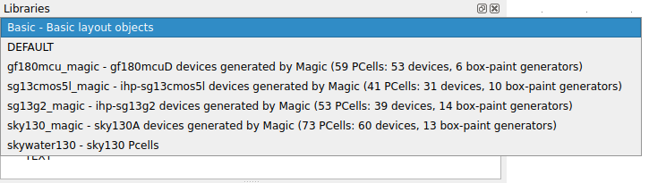

`Basic` comes with KLayout. `DEFAULT` and `skywater130`, the sky130A PDK's
own PCell library, come from the image's own KLayout setup. The `*_magic`
libraries aren't bound to a technology, so KLayout lists them whatever the
layout's technology is.

The PCells carry Magic's device names (`sky130_fd_pr__nfet_01v8`,
`nfet_03v3`, `sg13_lv_nmos`) and the names of Magic's box-paint generators,
the via, contact and well commands described under [Via, contact and well
PCells](#via-contact-and-well-pcells) (`via1`, `nwell`, `subconn_guard`).
The README's [Devices](README.md#devices) section lists them all.

## Place a device

Press Instance in the toolbar. In the Instance tab of the Tool Options
panel, set the library to `sky130_magic` and the cell to
`sky130_fd_pr__nfet_01v8`. The PCell tab then shows the device's
parameters, which are the entries, checkboxes and choices of Magic's own
parameter dialog for that device, with its labels. KLayout draws the
device at the pointer, before you place it:

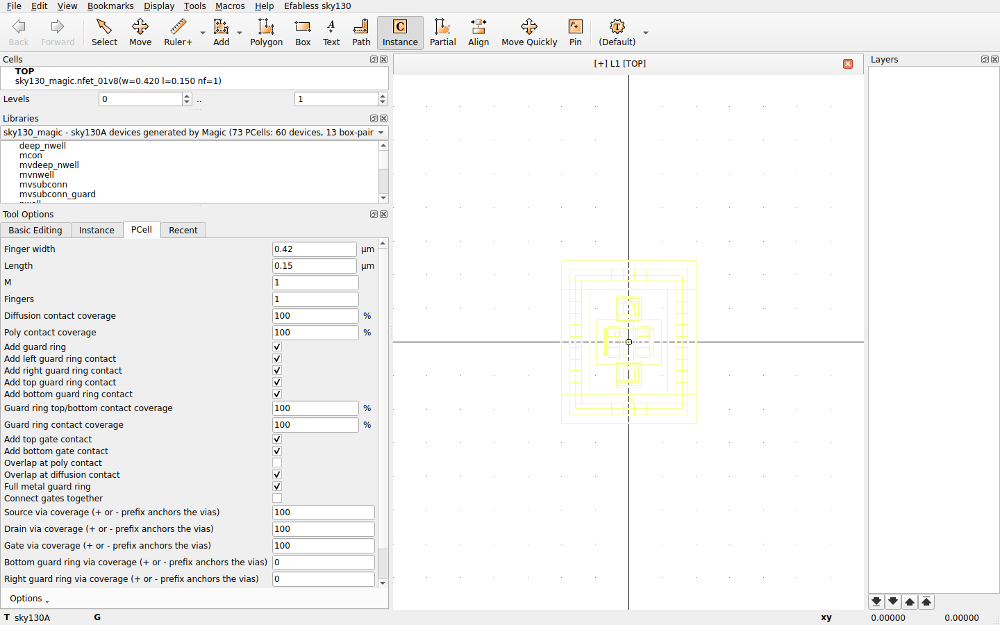

Finger width (`w`) is the width of one finger, as in Magic: `w` 1.5 with
Fingers (`nf`) 3 is 4.5 µm of total width.

### When Magic corrects a value

The values the PCell stores are the ones Magic's parameter dialog shows
after you type yours. When you change a field and press Return, the
package's own Magic process types the value into the device's "New device"
dialog, presses Return and then the dialog's Create button, as you would in
Magic. The form then shows what that dialog shows. Typing 0.1 into Length
gives 0.15, Magic's minimum length for this nfet, and the field gets a
warning icon. Its tooltip quotes Magic:

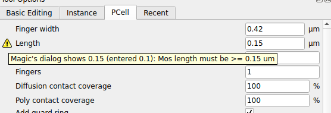

The same message goes to KLayout's log (File > Log Viewer). The device is
drawn and stored with `l` = 0.15, which is what the cell would be if you
had typed 0.1 into Magic's own dialog. The correction comes from the PDK's
`_check` procedure and the dialog's callbacks, run in Magic. The README's
[Values as Magic's dialog shows
them](README.md#values-as-magics-dialog-shows-them) has the model and more
examples.

A value Magic's dialog shows in SPICE notation shows as a number. On
`sky130_fd_pr__res_high_po_0p69`, for example, the Value field shows 1028
with a warning icon whose tooltip reads `Magic's dialog shows 1.028k here,
which this field can only show as 1028.0`.

KLayout's PCell tab doesn't hand the PCell the dialog state that it stores
for a variant (a run that logged what KLayout passed to the PCell showed
that state empty in this tab). So each change in the tab goes into a fresh
New device dialog, together with every other field that differs from
Magic's defaults, including fields that only Magic changed. On
`sky130_fd_pr__cap_mim_m3_1`, typing 5 into Length put a warning on Value,
`Magic's dialog shows 22.66 (entered 9.52)`, and typing 3 into Width then
gave `Magic's dialog shows 33.04 (entered 22.66)`, although Value was never
typed. Editing a placed instance through its Properties dialog keeps the
state (see [Edit a placed device](#edit-a-placed-device)).

### Placing the instance

Click in the layout to place the device. KLayout makes one cell, a
variant, for each set of parameter values, and places it. If the device
shows as an empty frame with its name, choose Display > Full Hierarchy; the
shapes are one level below the top cell. This is the placed nfet with
sky130A's layer colours:

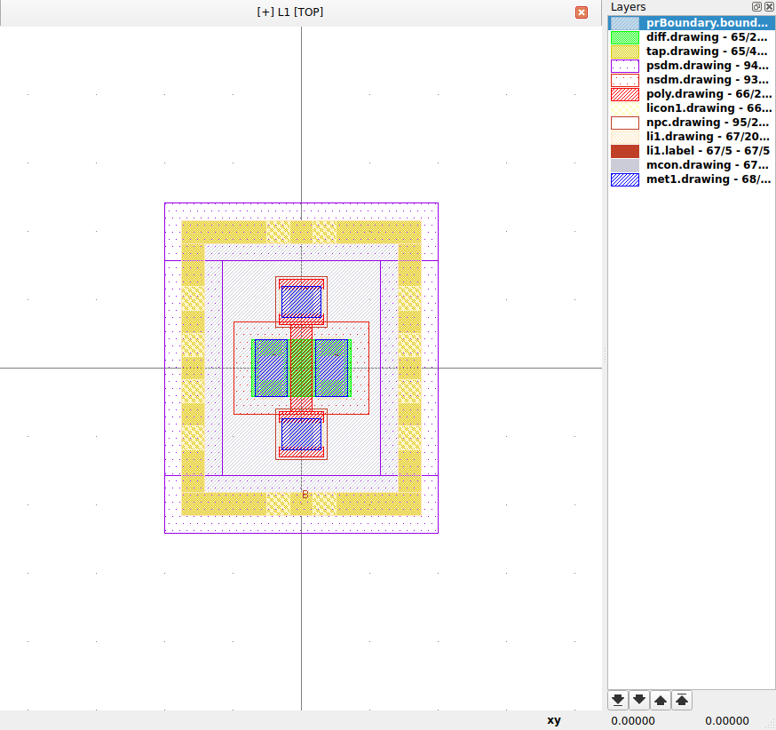

The Cells panel lists the variant as
`sky130_magic.nfet_01v8(w=0.420 l=0.150 nf=1)`, with the values Magic's
dialog shows.

## Edit a placed device

Select the instance and choose Edit > Properties. The Instance Properties
dialog has a PCell parameters tab with the same fields. Type a value and
leave the field (Tab, or a click into another field): KLayout changes the
instance at once. Return in a field presses the dialog's Ok button.

For a placed instance, a change is the one that Magic's "Edit device"
dialog and its Apply button would make. The package's Magic process starts
from what Magic's dialog showed for the instance, types the change and
presses Apply. In the run below, Finger width was typed as 1.0 (the
instance became `w=1.0`) and then as 0.3. Magic's dialog shows 0.42 for
that, so the field reads 0.42 and the instance went back to `w=0.420`:

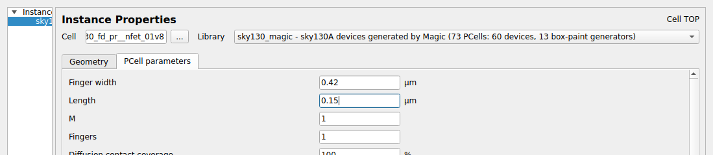

This dialog showed no icon for the correction; the warning is in the Log
Viewer (File > Log Viewer), as the last of three. The first is the Length
correction from [When Magic corrects a value](#when-magic-corrects-a-value),
and the second comes from the via in the next section, which the run
placed before it made this edit:


## Via, contact and well PCells

The via, contact, substrate-contact, guard-ring and well commands of
Magic's Devices menus paint into the cursor box instead of opening a dialog.
Each has a PCell with two parameters, the box's width `w` and height `h` in
µm, and the PCell draws what Magic paints into a box of that size at the
origin. With no dialog in Magic, these PCells keep the size you type; Magic
rounds it to its 5 nm grid.

Below a generator's minimum box, Magic paints nothing and prints a message.
The PCell then draws an empty cell, and the side the message names gets a
warning icon. `via1` with a width of 0.2 µm:

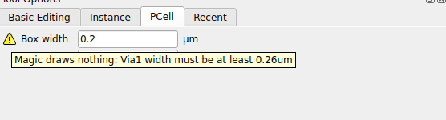

With `w` 1.0 and `h` 0.5, `via1` draws three via cuts with metal1 and
metal2 around them. The `nwell` PCell is Magic's "n-well region with guard
ring (1.8V)" command; with `w` 3.0 and `h` 2.0 it draws the n-well with a
guard ring whose contact strips are centred on the box's edges. A
box-paint PCell's origin is its box's lower-left corner. Here are the nfet,
the via placed at (3, 0) µm and the n-well placed at (5, -1) µm:

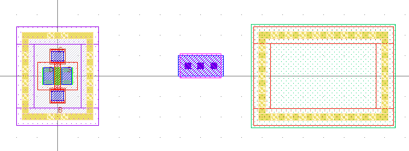

The README's [Box-paint generators](README.md#box-paint-generators) section
lists every generator with its minimum box.

## Stamps on a generated cell

Each variant holds a flat copy of the GDS that Magic wrote for it, and two
stamps that record which Magic, PDK and generator code made it.

The first stamp is a GDS property, attribute 100, on one shape of the
cell: the prBoundary box (235/4) on sky130A devices that have one. KLayout
shows it under the shape's Edit > Properties > User Properties. In this
screenshot the macro selected the nfet's boundary box inside the instance
and opened that dialog:

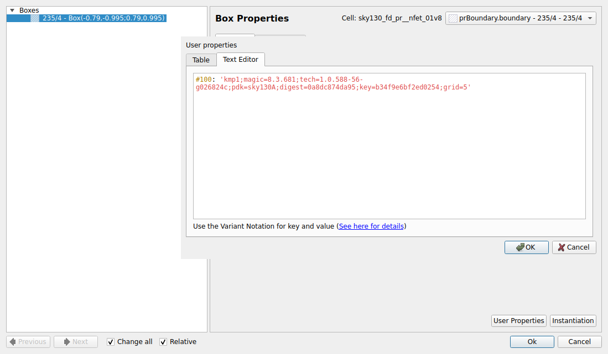

The fields are the Magic version, the PDK's tech version and name, a digest
over the generator code and the PDK's Magic and vendor files, the first 16
hex digits of the cache key, and the coarsest grid, in nm, that all of the
cell's coordinates lie on. The property stays in the file when it is saved
as GDS or OASIS.

The second stamp is a hidden PCell parameter, `kmp_created`, which KLayout
saves with the other parameters. For the nfet above it holds
`kmp1;magic=8.3.681;tech=1.0.588-56-g026824c;pdk=sky130A;digest=0a8dc874da95`.
When a file is opened again under another Magic, another PDK version or
edited generator code, the PCell logs a warning that the instance was
created with one stamp and regenerated with another. A third hidden
parameter, `kmp_dialog`, holds the state of Magic's dialog for the instance
(the form that Create or Apply was pressed with, and what the dialog showed
afterwards), so that reopening a file doesn't type the values into Magic's
dialog again.

`audit` reads these stamps from a file; see [The command
line](#the-command-line). The README's [Stamps and
audit](README.md#stamps-and-audit) section has the details.

## Save and reopen

Save the layout as usual. KLayout stores each PCell instance as its library
name, PCell name and parameters, together with a copy of the geometry.

When the file is opened with the libraries registered, KLayout draws every
variant again, from the package's disk cache or by asking Magic. The values
stay as they were saved: Magic's dialog doesn't run again on them, and the
Log Viewer stayed empty when this file was reopened. The Cells panel shows
the live PCells:

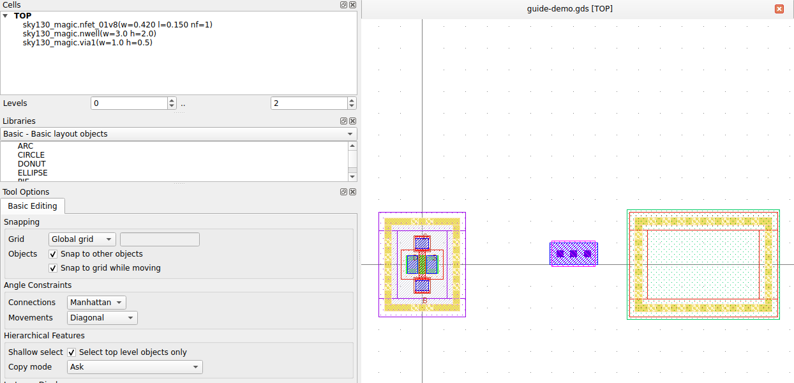

Opened in a session where `sky130_magic` isn't registered (here
`KMP_PDKS=gf180mcuD`), the same cells show as `<defunct>` and keep the
geometry saved in the file (and, the README says, saving keeps it):


A restart with sky130A selected again registers its library. The README
says that `klayout_magic_pcells.register()` in the macro console, called
after the setting is fixed, also registers it, and that the open cells then
come back as live PCells. Neither step is shown here.

## The Magic menu

The package also runs Magic's own checks on a layout open in KLayout:
Magic's DRC, its extraction, and LVS against a schematic with netgen,
plus two checks of what Magic reads differently from KLayout. They are in
a menu named Magic, which the autorun macro puts before Help:

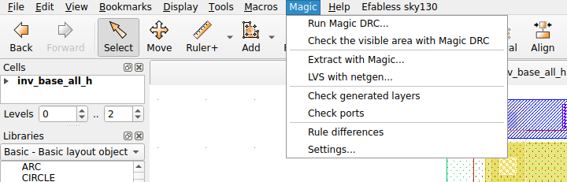

An entry checks the cell that the current view shows, as it is in memory,
unsaved edits included. It writes that cell and everything under it to a
GDS file, which this guide calls the export, and has Magic read the export
in a process of its own (`magic -dnull` with the PDK's rcfile), separate
from the Magic processes of the PCell libraries. [The PDK a check
uses](#the-pdk-a-check-uses) says which PDK's Magic that is. The checks
need Magic and the PDK's rcfile, and LVS also needs netgen and the PDK's
netgen setup file; when one is missing, the entry says so in a message
box and runs nothing.

While Magic runs, a progress dialog shows the check, Magic's stage and the
seconds so far, and KLayout stays usable. Here Magic checks a 250 × 250 µm
block of sky130A standard cells in flat mode:

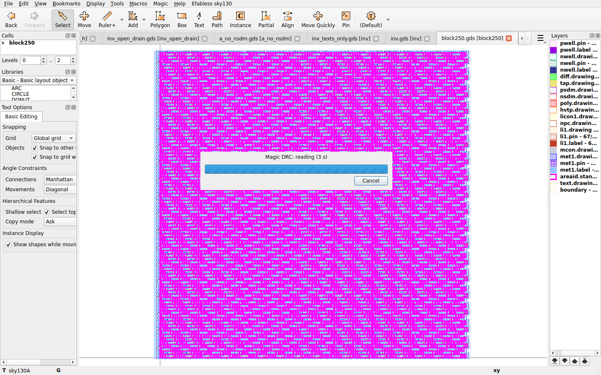

One check runs at a time in a view. If you choose another entry while one
runs, the package asks first:


No keeps the running check; Yes cancels it and starts the new one. The run
for this guide tried only No. Cancel in the progress dialog stops Magic,
and no report opens:

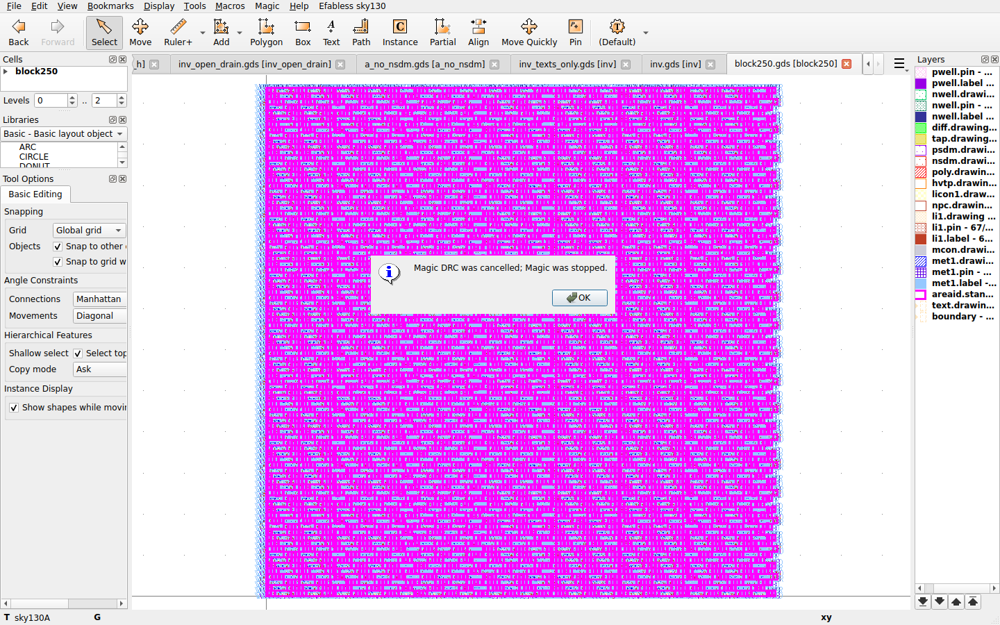

When a check ends, the Marker Database Browser opens on its report, and a
message box gives the result: a first line in plain words, such as "In
a_no_nsdm: 1 transistor that Magic reads as another device or none; 2
shapes or cuts that Magic drops (licon1.drawing).", and below it the
summary that the command line prints, sometimes with an extra line. The box is an
information box when the check found nothing, a warning when it found
something, and an error when the check failed. When you close it, the
browser comes in front of the main window; it is a window of its own, which
a maximised main window would otherwise cover. Two
kinds of check end without a progress dialog: a check whose result is
already in the [job cache](#job-directories) from an earlier run, and the
port check, which doesn't start Magic. The browser's Rerun button (F5) runs
the same check again on the layout as it is then and replaces the report.
The run for this guide reran a DRC report this way; Rerun on the other
checks' reports wasn't tried.

In the browser's Info pane, a finding's text is split into lines of at
most 80 characters, a sentence or clause to a line, because the pane
doesn't wrap a text and cuts a line after 200 characters. To read the
lines whole, make the pane wider by dragging the splitter between
Directory and Markers to the left. Items that are information and not
findings, such as the export's notes in a DRC report or the device list
of the generated-layer check, are marked waived: KLayout draws their
categories in green and writes their number after a dash in the count
column. The report of the inverter without nsdm under [Check generated
layers](#check-generated-layers) holds six items, three of them
information, so before you look at any its count reads "6 (3) - 3".

`KMP_MENU=0` leaves the menu out, and `klayout -b` has no menu. The same
checks run from the shell (see [The command line](#the-command-line)), and
the README's [Checking a layout with
Magic](README.md#checking-a-layout-with-magic) describes each of them in
full.

The examples below use layouts of the case suite, the test layouts that
`tests/cases/build.py` draws for each PDK, in sets such as `hier`, `gaps`
and `inverters`; a case is the file `<set>/<case>.gds`. The screenshots
show them open in KLayout under the sky130A technology. The command-line
transcripts of these sections were run on 2026-11-24 with version 0.6.0,
and those of `drc` on hierarchical cases and of `layers` on `a_no_nsdm`
again with version 0.6.2, through `scripts/in_image.sh`, which mounts the
repository at `/repo` and sets `KMP_CACHE_DIR=/repo/out/cache`. The cases
were built with

```
$ python3 tests/cases/build.py --pdk sky130A --out out/cases/sky130A
```

and each command ran in the folder of its file. The case suite's files
name no technology, so each command first prints a note that the PDK is a
guess from the `PDK` variable (see [The PDK a check
uses](#the-pdk-a-check-uses)); the transcripts leave it out after the
first.

## Magic DRC

Magic > Run Magic DRC... asks for the DRC style, the mode and the area:

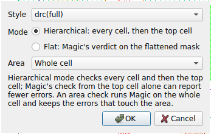

The styles are the PDK's: `drc(fast)`, `drc(full)` and `drc(routing)` on
all four PDKs. The first time, the dialog offers `drc(full)` and the
hierarchical mode, or the style and mode that `KMP_DRC_STYLE` and
`KMP_DRC_MODE` set; after that, it offers what you chose last, which it
keeps in `state.json` beside `config.ini`. The area is the whole cell, the
area the view shows (see [Check the visible area](#check-the-visible-area)),
or the box around the selection.

The two modes:

- **Hierarchical** reads the export as Magic reads any GDS file and checks
  every cell on its own, children first, then the top cell. The top
  cell's errors go into the top cell in the report. A subcell's box that
  the top cell's check also lists is left out, since the top cell's box
  reports it; a subcell keeps the boxes that the top cell's check lacks.
- **Flat** has Magic check the flattened cell, which gives Magic's verdict
  on the mask.

They differ when a cell's devices depend on layers drawn in another cell,
because Magic decides what each piece of diffusion and poly is inside each
cell, from that cell's own implants and wells. The case
`hier/inv_base_all_h` is the case suite's hand-drawn inverter with its
nsdm, psdm, n-well, hvtp and npc in the top cell, `inv_base_all_h`, and
its diffusion, poly, contacts and metal in a subcell, `inv_base_all_dev`.
Flattened, it is the clean inverter; Magic reads the subcell without
implants and well. The same check from the command line, in both modes:

```
$ python3 -m klayout_magic_pcells drc inv_base_all_h.gds -o inv_base_all_h.lyrdb
note: PDK sky130A, a guess from the PDK variable (PDK=sky130A): the layout names no technology and no PCell library; give --pdk to choose another
Magic DRC (drc(full), hierarchical) of inv_base_all_h on sky130A: 36 error boxes, 7 rules, in 1 cell. inv_base_all_h: 36 error boxes; Magic's drc list count total 5 in the top cell, 7 over the 2 cells checked; of the 47 boxes the subcells' own checks list, 7 are in the top cell's check (reported there), 0 only in the flattened layout's check, 40 only when the subcell is checked on its own (information, not counted). The export has 9 findings (category Export).
$ python3 -m klayout_magic_pcells drc inv_base_all_h.gds --mode flat
Magic DRC (drc(full), flat) of inv_base_all_h on sky130A: no errors. inv_base_all_h: 0 error boxes; Magic's drc list count total 0 in the top cell. The export has 1 finding (category Export).
```

The hierarchical check exits 1, the flat one 0. The browser shows the
errors by cell, and under each cell by rule:


Each category under Magic DRC is a rule ID, the text in the last
parentheses of Magic's message, and the category under it is the message
itself. A message without an ID, such as "Can't overlap those layers", is
a category of its own. Magic's error list has no layer, so the rule's
description, in the Info pane, says what Magic checks: the message, the
styles that have the rule, the tech-file statement with its line, the
Magic types, and the GDS layers that Magic writes those types on. The
last lines are the rule's rows in the [gap table](#rule-differences),
one `Gap table:` line for each row that holds one of the rule's
statements, with its status and the rule's names in the PDK's KLayout
decks. A line names its row when the row's rule ID isn't the one that
Magic prints: sky130A's Magic prints `hvi.5` for a spacing that SkyWater's
rules call `hvi.2a`, and that message's line reads
`Gap table: both (row hvi.2a); KLayout: sky130A_mr.drc: hvi.2a (0.7); sky130A.lydrc: hvi.2 (0.7)`.
In the screenshot, taken with version 0.6.2, the Info pane gives the
description of nwell.2a, with `GDS layers: 64/20 (nwell.drawing), 82/44
(pnp.drawing)` and its `Gap table:` line. Export and the cell
`inv_base_all_dev` are in green: they hold only information (see [The
Magic menu](#the-magic-menu)).

### A subcell's own boxes

Hierarchical mode checks each subcell outside its parent, so its check
can list boxes that the parent's shapes would settle. A box from a
subcell's own check is left out of the report when the top cell's check
lists a box of the same rule there: the top cell's box reports it. When
the top cell's check lists none, the box is an error in the subcell if
Magic's check of the flattened layout has one there, and the item's text
then ends "Magic's check from the top cell misses this box; Magic's check
of the flattened layout confirms it". Any other box goes into a category
"only when <cell> is checked on its own" under its rule. Those items are
information: they don't count as errors, don't change the exit status
and aren't among the rows of `--tsv`.

In the run above, `inv_base_all_dev`'s own check listed 47 boxes. The top
cell's check lists the 7 of them in nwell.2a, nwell.1, nwell.4 and LU.3
too, so they are reported once, in `inv_base_all_h`, with the top cell's
other boxes. The other 40 are information, under "only when
inv_base_all_dev is checked on its own" in diff/tap.8 (36), nwell.1 (2)
and LU.3 (2). In KLayout, the message box adds a line for them:

```
40 boxes only when inv_base_all_dev is checked on its own (information, not counted as errors): LU.3 2, diff/tap.8 36, nwell.1 2.
```

The flattened check is one more Magic job, run only when some subcell box
is not in the top cell's check, and it costs about as much as `--mode
flat`. On `inv_base_all_h` it took 0.8 s. On a 100 × 100 µm block of 1,244
sky130A standard cells, built the same way as the 250 µm block of the
progress screenshot, the hierarchical check took 16 s without the job
cache, 7.7 s of them in the flattened layout's check, and `--mode flat`
took 7.9 s. The report's
description gives the flattened check's time and job directory.

The case suite's inverter built from this package's PCells has such boxes
too. Its file holds the PCell variants, so the PDK comes from them and
there is no note:

```
$ python3 -m klayout_magic_pcells drc inv_pcell.gds -o inv_pcell.lyrdb
Magic DRC (drc(full), hierarchical) of inv_pcell on sky130A: no errors. inv_pcell: 0 error boxes; Magic's drc list count total 0 in the top cell, 6 over the 3 cells checked; of the 6 boxes the subcells' own checks list, 0 are in the top cell's check (reported there), 0 only in the flattened layout's check, 6 only when the subcell is checked on its own (information, not counted). The export has 12 findings (category Export).
```

It exits 0. The two transistor cells, checked on their own, have three
met1.6 boxes each. One of the six items, under "met1.6/only when
sky130_fd_pr__nfet_01v8__kmp_e044c2db is checked on its own", reads:

```
Metal1 minimum area < 0.083um^2 (met1.6); Magic types: allm1, obsm1; GDS layers: 68/20 (met1.drawing), 68/13 (met1.res), 68/98 (MET1BLOCK); information only
```

### Export findings

When the package writes the export, before Magic starts, it also looks for
what Magic will read differently from KLayout. The reports of the DRC, the
extraction, LVS and the generated-layer check list these findings under
Export:

- shapes off the 5 nm grid, which Magic snaps;
- layers that Magic's GDS reader ignores, such as sky130A's npc, which
  Magic draws itself when it writes GDS;
- layers that Magic reads as another type;
- "Magic reads this cell without a layer drawn in another cell": an
  implant or marker drawn in one cell over diffusion or poly of another
  cell, or a well over diffusion of another cell, where that cell doesn't
  draw the layer itself. The other cell can be the parent, a child or a
  sibling. Contacts and vias under the layer don't count; a contact takes
  its type from the diffusion or poly under it in its own cell.
  `inv_base_all_h` has 8 of these;
- instances that Magic can't place, which the export flattens, and cells
  renamed because Magic can't load their names;
- PCell variants that failed and carry the error marker (see the README's
  [If Magic is missing or fails](README.md#if-magic-is-missing-or-fails)).
  Every check that runs Magic stops on such a layout before starting
  Magic, and exits 2;
- "Magic reads nothing in this cell".

The last one is a finding, not a failed check. A cell may hold only layers
that Magic's reader ignores, or reads only to decide what the diffusion or
poly under them is. Magic then loads an empty cell and has nothing to
check. `gaps/s_npc_alone` is one npc rectangle:

```
$ python3 -m klayout_magic_pcells drc s_npc_alone.gds
Magic DRC (drc(full), hierarchical) of s_npc_alone on sky130A: Magic reads nothing in s_npc_alone, so nothing was checked (category Export/Magic reads nothing in this cell). The export has 1 finding (category Export).
$ python3 -m klayout_magic_pcells layers s_npc_alone.gds
layers on sky130A, cell s_npc_alone: F1 0, F2 0, F3 0, F4 0; F5 0 (information); 0 devices in Magic's extraction; export: 0 off grid, 1 on unread layers, 0 read as another type, 0 cross-cell; Magic reads nothing in cell s_npc_alone. Its layers: 95/20 (npc.drawing): Magic's reader ignores it (and draws its own when it writes GDS) (sky130A.tech:3979), so there is nothing to compare (category Export/Magic reads nothing in this cell)
Export: Magic reads nothing in cell s_npc_alone. Its layers: 95/20 (npc.drawing): Magic's reader ignores it (and draws its own when it writes GDS) (sky130A.tech:3979)
```

Both exit 1. `extract` and `lvs` give the same finding on such a cell and
also exit 1: `extract` writes no netlist, and `lvs` says that the layout
does not match, without running netgen. A subcell that Magic reads as
empty is not checked, and the DRC report's description names it ("cells
empty to Magic, not checked").

## Check the visible area

Magic > Check the visible area with Magic DRC takes the style and mode
last chosen in the DRC dialog, or the defaults before its first use, and
checks the area that the view shows. Here the view shows the lower part of
the inverter:

![The lower part of inv_base_all_h zoomed in, with the browser on the database "Magic DRC drc(full): inv_base_all_h[1]", whose Magic DRC category of inv_base_all_h has its eleven markers selected](docs/img/guide/magic-drc-visible.png)

Magic still checks the whole cell, and the report keeps the errors that
touch the area. Checking only the area would get rules about a whole shape
wrong, such as sky130A's nwell.4, which wants a tap somewhere in each
n-well. The job cache doesn't depend on the area, so after a check of the
whole cell, an area check of the unchanged cell doesn't start Magic. On
the command line, `--box` takes the area in µm, in the top cell's
coordinates:

```
$ python3 -m klayout_magic_pcells drc inv_base_all_h.gds
Magic DRC (drc(full), hierarchical) of inv_base_all_h on sky130A: 36 error boxes, 7 rules, in 1 cell. inv_base_all_h: 36 error boxes; Magic's drc list count total 5 in the top cell, 7 over the 2 cells checked; of the 47 boxes the subcells' own checks list, 7 are in the top cell's check (reported there), 0 only in the flattened layout's check, 40 only when the subcell is checked on its own (information, not counted). The export has 9 findings (category Export).
$ time python3 -m klayout_magic_pcells drc inv_base_all_h.gds --box -0.592,0,1.592,1.5
Magic DRC (drc(full), hierarchical) of inv_base_all_h on sky130A in the area -0.592,0,1.592,1.5 um: 11 error boxes, 4 rules, in 1 cell. inv_base_all_h: 11 error boxes; Magic's drc list count total 5 in the top cell, 7 over the 2 cells checked; of the 9 boxes the subcells' own checks list, 1 is in the top cell's check (reported there), 0 only in the flattened layout's check, 8 only when the subcell is checked on its own (information, not counted). The export has 9 findings (category Export).

real	0m0.161s
```

The area is the one that the view of the screenshot showed. The second
command took 0.16 s, since it read the first command's results from the
job cache.

## LVS with netgen

Magic > LVS with netgen... asks for the schematic, a SPICE or CDL file,
and one of its subcircuits:

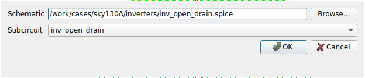

The list holds the file's `.subckt` names and preselects the one named
like the cell. The dialog keeps the schematic and the subcircuit for each
layout file and cell in `state.json`. Browse... lists every SPICE file of
the folder, the netlists that Extract with Magic wrote there
(`<cell>.magic.spice`) among them; when you choose one of those, the
dialog asks whether to use it anyway, since LVS would then compare
Magic's netlist with itself. The check extracts the cell with
Magic, as Extract with Magic does, and has netgen compare that netlist with
the subcircuit, using the PDK's netgen setup file. The layout here is
`inverters/inv_open_drain`, the hand-drawn inverter with its Y wire cut
between the NMOS and PMOS drains, so that the NMOS drain floats. Its
schematic is the plain inverter:


A net that netgen could not pair is marked with the shape that lies at the
point Magic's `.ext` file gives for the net: here the NMOS drain's
diffusion to the right of the gate, which Magic names `a_300_260#`.
netgen's report opens in a window of its own, scrolled to its end, where
netgen's final result is. From the command line:

```
$ python3 -m klayout_magic_pcells lvs inv_open_drain.gds --schematic inv_open_drain.spice -o inv_open_drain.lyrdb --report inv_open_drain.lvs.txt
lvs: inv_open_drain against inv_open_drain in inv_open_drain.spice (sky130A): netgen: Netlists do not match. The layout does not match. 2 markers in the report.
  netgen/net only in the layout: a_300_260#, Magic type ndif at (1.500, 1.300): layout sky130_fd_pr__nfet_01v8 pin 1|3 x1; netgen found no schematic net to pair it with
  netgen/nets that differ: Y, Magic type li at (2.250, 2.600): layout sky130_fd_pr__pfet_01v8_hvt pin 1|3 x1; schematic sky130_fd_pr__nfet_01v8 pin 1|3 x1, sky130_fd_pr__pfet_01v8_hvt pin 1|3 x1
  Export/Magic does not read this layer: 1 item
$ python3 -m klayout_magic_pcells lvs inv.gds --schematic inv.spice
lvs: inv against inv in inv.spice (sky130A): netgen: Circuits match uniquely. The layout matches.
  Export/Magic does not read this layer: 1 item
```

The first exits 1, the second 0. `lvs` reports a match only when netgen's
final result says the circuits match and no property, pin or port error
follows. `--report` copies netgen's report, and `--json` writes the
verdict and the findings. The netgen in the image is 1.5.323.

## Extract with Magic

Magic > Extract with Magic... names the cell and asks for the netlist
only or the netlist with parasitic capacitance:

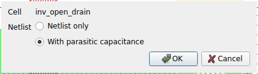

Magic reads the export with its hierarchy, extracts it and writes a SPICE
netlist, which a window then shows as Magic wrote it:

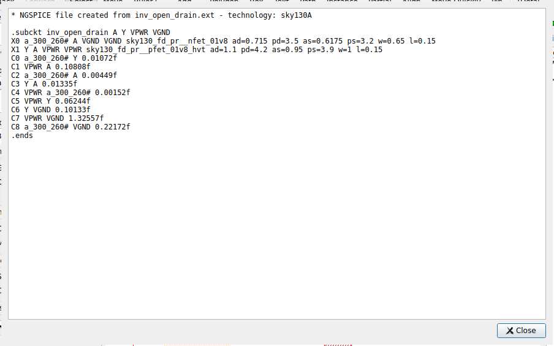

The check also writes the netlist beside the layout file, as
`<cell>.magic.spice`, or `<cell>.magic.pex.spice` with capacitance, with a
first line of its own in front of Magic's netlist. It replaces a file of
that name only when the file starts with that line, so a file of yours with
that name stays as it is. When the file there isn't the plugin's, when the
file can't be written, or when the layout has never been saved, the message
says "Not written: ..." and a save dialog opens. From the command line,
where the second `extract` finds an `inv_open_drain.magic.spice` that the
plugin didn't write:

```
$ python3 -m klayout_magic_pcells extract inv_open_drain.gds --caps
extract: Magic extracted inv_open_drain (with parasitic capacitance, sky130A) into /repo/out/cases/sky130A/inverters/inv_open_drain.magic.pex.spice. The report has 1 item about the export.
netlist: /repo/out/cases/sky130A/inverters/inv_open_drain.magic.pex.spice
  Export/Magic does not read this layer: 1 item
$ head -3 inv_open_drain.magic.pex.spice
* Written by klayout_magic_pcells 0.6.0: Magic's netlist of inv_open_drain (with parasitic capacitance, sky130A) from /repo/out/cases/sky130A/inverters/inv_open_drain.gds
* NGSPICE file created from inv_open_drain.ext - technology: sky130A
$ printf "* my own netlist\n" > inv_open_drain.magic.spice
$ python3 -m klayout_magic_pcells extract inv_open_drain.gds --rdb inv_open_drain.extract.lyrdb
extract: Magic extracted inv_open_drain (netlist only, sky130A). The report has 1 item about the export.
error: /repo/out/cases/sky130A/inverters/inv_open_drain.magic.spice exists and klayout_magic_pcells did not write it (its first line is not "* Written by klayout_magic_pcells ..."); pass -o OUT.spice to write the netlist elsewhere, or -o /repo/out/cases/sky130A/inverters/inv_open_drain.magic.spice to overwrite it
```

The first `extract` exits 0, and running it again replaced the file it had
written. The last exits 2 and leaves `inv_open_drain.magic.spice` alone.
`-o` writes the netlist where you say. `--rdb` saves the report, with the
export's findings, also when the command exits 2, as here. `extract` exits
1 when a placed PCell variant holds a device that Magic's GDS reader
doesn't keep; the README's [Extraction](README.md#extraction) section lists
those devices.

## Check generated layers

Magic reads implants and markers only to decide what the diffusion and
poly under them are, and draws its own when it writes GDS. Magic >
Check generated layers has Magic read the export, write it back and
extract a copy that Magic flattened itself, and then compares the result
with the layout in KLayout. The report's categories:

| Category | What it marks |
|---|---|
| F1 implant or marker stops short | an implant or marker that encloses a device shape by less than the distance Magic grows that layer from the shape when it writes GDS |
| F1 Magic draws more of this layer here (information) | the items of the row above, as information only, on a PDK whose `devices-<pdk>.json` makes F1 information; F1 is a check on all four PDKs, so this category doesn't appear |
| F2 transistor Magic reads as another device or none | a gate that Magic's extraction makes into another device, two devices or none |
| F3 shape Magic drops | conductor, poly, diffusion or cuts that Magic doesn't write back |
| F4 conductor Magic adds | conductor that Magic writes and the layout doesn't have |
| F5 cuts Magic redrew (information) | contacts and vias that Magic replaced with its own |
| Devices Magic extracted (information) | every device of Magic's extraction |

The check exits 1 on an F1 to F4 item, or on an export finding of a shape
off the grid, a layer read as another type or a layer drawn in another
cell. The case `gaps/a_no_nsdm` is the inverter without nsdm over its NMOS
diffusion:


```
$ python3 -m klayout_magic_pcells layers a_no_nsdm.gds -o a_no_nsdm.lyrdb
layers on sky130A, cell a_no_nsdm: F1 0, F2 1, F3 2, F4 0; F5 0 (information); 2 devices in Magic's extraction; export: 0 off grid, 1 on unread layers, 0 read as another type, 0 cross-cell
F2 gate: The gate at (1.350, 1.300): it is outside nwell, but Magic reads it as sky130_fd_pr__pfet_01v8 W 0.650 L 0.150. The gate has no nsdm over its diffusion, and Magic reads every such gate as a pfet, whatever the well (sky130A.tech:2597). To fix it, draw nsdm (93/44) over the n-diffusion, 0.125 um past it.
F3 licon1.drawing: Magic drops this licon1.drawing cut at (0.550, 1.550)-(0.720, 1.720). The cut has li over it, but the diffusion under it has neither nsdm nor psdm, and Magic makes a contact on diffusion or tap only where one of the two is drawn; with the implant drawn, the contact comes back (sky130A.tech:3133-3227)
F3 licon1.drawing: Magic drops this licon1.drawing cut at (2.280, 1.550)-(2.450, 1.720). The cut has li over it, but the diffusion under it has neither nsdm nor psdm, and Magic makes a contact on diffusion or tap only where one of the two is drawn; with the implant drawn, the contact comes back (sky130A.tech:3133-3227)
```

It exits 1. The README's [Generated layers](README.md#generated-layers)
section has the rules F1 measures for each PDK.

## Check ports

Magic and the PDK's KLayout LVS deck take pins from texts and pin boxes,
and not always from the same ones. Magic > Check ports compares each
cell's texts and pin boxes with the PDK's label convention, in KLayout,
without Magic:

| Category | What it marks |
|---|---|
| P1 text neither Magic nor KLayout's LVS reads | a text on a layer that neither tool reads |
| P2 text names a net in Magic but makes no port | a text that names a net in Magic without making it a port; netgen matches pins by Magic's ports, so pin matching fails |
| P3 Magic port KLayout's LVS can't name | a text that Magic makes a port, on a layer the KLayout deck doesn't read net names from |
| P4 pin box with no text | a pin box without a text over it |
| P5 pin box with no drawing under it | a pin box that Magic reads as conductor and KLayout's decks don't |
| P6 text over no shape of its layer | a text over no shape of its conductor layer |
| P7 texts inside device cells | texts inside PCell or library cells on a layer that KLayout's LVS reads, whose flat LVS joins every net of that name |
| P8 pin missing from Magic's subcircuit ports | a pin text of the top cell that is missing from the ports of the subcircuit Magic extracts; only `ports --magic` on the command line checks it |

`inverters/inv_texts_only.gds` isn't one of the case suite's files:
`tools/screenshots/magic_inputs.py` makes it from the case `inverters/inv`,
the hand-drawn inverter, by taking out its pin boxes and keeping its texts:


```
$ python3 -m klayout_magic_pcells ports inv_texts_only.gds -o inv_texts_only.lyrdb
ports on sky130A, cell inv: P1 0, P2 4, P3 0, P4 0, P5 0, P6 0, P7 0
P2 inv: text 'A' at (1.425, 2.525) on 67/5 (li1.label) names a net in Magic but makes no port, so netgen fails pin matching. The form both accept is a text on 67/5 over a box on 67/16.
P2 inv: text 'Y' at (2.375, 2.725) on 67/5 (li1.label) names a net in Magic but makes no port, so netgen fails pin matching. The form both accept is a text on 67/5 over a box on 67/16.
P2 inv: text 'VPWR' at (1.325, 5.825) on 68/5 (met1.label) names a net in Magic but makes no port, so netgen fails pin matching. The form both accept is a text on 68/5 over a box on 68/16.
P2 inv: text 'VGND' at (1.325, 0.175) on 68/5 (met1.label) names a net in Magic but makes no port, so netgen fails pin matching. The form both accept is a text on 68/5 over a box on 68/16.
$ python3 -m klayout_magic_pcells ports inv.gds --magic
ports on sky130A, cell inv: P1 0, P2 0, P3 0, P4 0, P5 0, P6 0, P7 0, P8 0; Magic's ports: A Y VPWR VGND
```

The first exits 1. The second, on the inverter with its pin boxes, exits 0,
and Magic's extraction gives the four ports.

The foundry's standard cells carry their own name as a text on sky130A's
`text.drawing` (83/44), and VNB as a text on `pwell.label` (64/59) over a
`pwell.pin` (122/16) box. Magic reads 83/44 as comments, which name no
net, so the check reports nothing for those texts, and it counts the
text on 64/59 as the pwell.pin box's text.

## Rule differences

Magic's DRC and the PDK's KLayout DRC decks don't check the same rules in
the same way. For each PDK the repository has a generated table of the
rules and where the two differ, the gap table `docs/gaps/<pdk>.md`. Magic >
Rule differences shows the gap table of the layout's PDK:

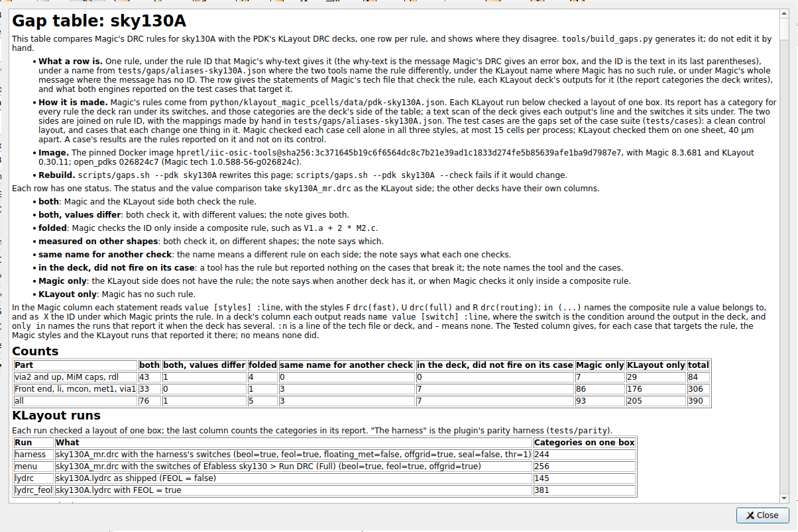

A row is one rule ID, with one of these statuses: both; both, values
differ; folded (Magic checks the ID only inside a composite rule); measured
on other shapes; same name for another check; in the deck, did not fire on
its case; Magic only; KLayout only. The DRC report's rule descriptions
quote the rows, as in the Info pane under [Magic DRC](#magic-drc). The
screenshot, taken with version 0.6.2, shows the sky130A page with 390
rules and 132 cases.
The window opens no larger than the screen, and its title bar's
maximise button maximises it (under XFCE, so does a double-click on the
title bar).
`tools/build_gaps.py` makes the tables from the PDK data, the decks, and
runs of both tools on the case suite's gaps cases.
`scripts/gaps.sh --pdk sky130A` rebuilds the sky130A table, and with
`--check` it fails when the table would change. The README's [Where KLayout and Magic
disagree](README.md#where-klayout-and-magic-disagree) section has the
details and the current counts. When the package is installed without
its `docs` folder, the entry says where it looked for the table.

## Settings

Magic > Settings... lists every setting with where to set it, its value and
where the value came from, for the PDK of the current layout:


The window only shows the settings; you change them as in [Choose the
PDKs](#choose-the-pdks), with a variable or in `config.ini`. The Magic
menu reads them at each run, and the PCell libraries when KLayout starts.
Under the table the window names a missing netgen or netgen setup file.
`KMP_JOB_KEEP` (see [Job directories](#job-directories)) is read from the
environment only and isn't in the table. `doctor` prints the same
settings.

## The PDK a check uses

A check takes the layout's PDK from the first of these that names one:

1. the layout's technology (sky130A, gf180mcu, sg13g2 or sg13cmos5l),
   when the layout's shapes fit that PDK's layers: at least 3/4 as many of
   them must be on its layers as on the layers of the PDK that fits best
   (shapes on text and boundary layers don't count);
2. this package's PCell libraries that the layout's variants come from,
   registered or `<defunct>`, or else the names of its variant cells
   (`<device>__kmp_<8 hex>`);
3. `KMP_PDKS`, when it selects one PDK.

The two IHP PDKs share their layer numbers, so between them the
technology decides. When none of the three decides, the menu asks. The
answer holds for that layout until KLayout closes. The question
preselects a guess. For a sky130A inverter opened under the technology
sg13g2, the guess is the PDK that the layers fit:


For a layout that names no technology, the question begins "The layout
names no technology and no PCell library of the plugin", and the guess is
the PDK that the `PDK` variable names, when it names one. When you open a
GDS file with File > Open, KLayout may give it a default technology; when
the layout's shapes don't fit that technology, the question names it, as
above.

On the command line the guess decides, and the command says so on stderr:
with the note `a guess from the PDK variable` of the transcripts above, or,
for a technology that the layers contradict, with `a guess from the layers:
the layout's technology is sg13g2 (ihp-sg13g2), but 0% of its shapes are
on ihp-sg13g2's layers and 89% on sky130A's; give --pdk to choose
another`. Without a guess it exits 2 and asks for `--pdk`, which names the
PDK outright. A GDS file doesn't keep KLayout's technology: a copy of the
inverter that KLayout wrote under sg13g2 read back without one. So for a
GDS file the command line goes by the other rules.

## The command line

The package has a command line for the shell. It needs the package's
`python` folder on `PYTHONPATH` and the `klayout` Python module, which the
image has (elsewhere, `pip install klayout`; the README's
[Requirements](README.md#requirements) give the version tested). A device
name is looked up in the selected PDKs; a name that several PDKs have, such
as `via1`, needs `--pdk`.

`devices` lists the PCells, and with `-v` their parameters:

```
$ python3 -m klayout_magic_pcells devices -v --pdk sky130A | sed -n "/^  sky130_fd_pr__nfet_01v8 /,/^  sky130_fd_pr__nfet_01v8_lvt/p" | head -12
  sky130_fd_pr__nfet_01v8  [mos]
      w          float   default 0.420    Width (um)
      l          float   default 0.150    Length (um)
      m          int     default 1        M
      nf         int     default 1        Fingers
      diffcov    float   default 100      Diffusion contact coverage (%)
      polycov    float   default 100      Poly contact coverage (%)
      guard      bool01  default 1        Add guard ring
      glc        bool01  default 1        Add left guard ring contact
      grc        bool01  default 1        Add right guard ring contact
      gtc        bool01  default 1        Add top guard ring contact
      gbc        bool01  default 1        Add bottom guard ring contact
```

`check` types values into Magic's New device dialog, as the PCell form
does, presses Create, and prints what the dialog then shows that differs
from what you typed, with Magic's messages:

```
$ python3 -m klayout_magic_pcells check sky130_fd_pr__nfet_01v8 w=0.1 l=0.1
sky130_fd_pr__nfet_01v8: Magic's dialog shows w=0.42 (entered 0.1)
sky130_fd_pr__nfet_01v8: Magic's dialog shows l=0.15 (entered 0.1)
  message: Mos width must be >= 0.42 um
  message: Mos length must be >= 0.15 um
$ python3 -m klayout_magic_pcells check sky130_fd_pr__res_high_po_0p69 w=1.0
sky130_fd_pr__res_high_po_0p69: Magic's dialog shows w=0.69 (entered 1.0)
sky130_fd_pr__res_high_po_0p69: Magic's dialog sets val=1.028k
  message: Resistor width must be <= 0.690 um
```

For a box-paint generator it prints the box Magic paints, after rounding to
the 5 nm grid, or that Magic paints nothing:

```
$ python3 -m klayout_magic_pcells check --pdk sky130A via1 w=0.2 h=1.0
via1: Magic paints nothing on a 0.2 x 1.0 um box
  message: Via1 width must be at least 0.26um
$ python3 -m klayout_magic_pcells check --pdk sky130A via1 w=0.263 h=1.0
via1: Magic paints a 0.265 x 1.0 um box (entered 0.263 x 1.0)
$ python3 -m klayout_magic_pcells check via1 w=1 h=1
error: via1 is a device of sky130A, gf180mcuD, ihp-sg13g2, ihp-sg13cmos5l; choose one with --pdk
```

`check` exits 0 when Magic draws something and 1 when it draws nothing or
fails (the first `via1` above, and the last one, whose name is ambiguous).
It exits 2 for a value it refuses.

`generate` places one variant in a new layout and writes it to a file. It
stores the values Magic's dialog shows, as the GUI does, and prints the
dialog's correction as a warning:

```
$ python3 -m klayout_magic_pcells generate sky130_fd_pr__nfet_01v8 w=1.5 l=0.5 nf=3 -o nfet.gds
wrote nfet.gds: sky130_fd_pr__nfet_01v8__kmp_43604ed3 (sky130_magic.nfet_01v8(w=1.5 l=0.5 nf=3)), bbox (-1.965,-1.745;1.965,1.745) um
$ python3 -m klayout_magic_pcells generate sky130_fd_pr__nfet_01v8 l=0.1 -o nfet_short.gds
Warning: sky130_magic nfet_01v8: Magic's dialog shows l=0.15 (entered 0.1): Mos length must be >= 0.15 um
wrote nfet_short.gds: sky130_fd_pr__nfet_01v8__kmp_7fef7f47 (sky130_magic.nfet_01v8(w=0.420 l=0.150 nf=1)), bbox (-1,-1.205;1,1.205) um
```

`audit` reads a file without registering a library and reports the cells
of the four libraries: cells with the error marker, without a stamp, with no
shapes, stamped by another Magic, PDK or generator code, or whose
coordinates the file's database unit would round. With `--regen` it also
generates every cell again with the installed Magic and compares the
geometry. It exits 1 when it finds a problem.

```
$ python3 -m klayout_magic_pcells audit nfet.gds
nfet.gds: dbu 0.001 um
  sky130_fd_pr__nfet_01v8__kmp_43604ed3  ok
1 sky130_magic cells, 0 with problems
$ python3 -m klayout_magic_pcells audit nfet.gds --regen
nfet.gds: dbu 0.001 um
  sky130_fd_pr__nfet_01v8__kmp_43604ed3  ok
      regenerated: same as stored
1 sky130_magic cells, 0 with problems
```

The disk cache keeps Magic's GDS for each variant, so that reopening a file
needs no Magic call for variants already generated. Its entries sit in one
directory per PDK and set of versions (Magic, PDK, generator code, cache
format). The same cache directory holds the job directories of the [Magic
menu's checks](#job-directories). `cache stats` counts both, `cache prune`
deletes the entries and job directories of older versions of the selected
PDKs, and `cache clear` deletes every entry and every job directory:

```
$ python3 -m klayout_magic_pcells cache stats
{
 "entries": 2,
 "bytes": 20305,
 "versions": 1,
 "current": {
  "sky130A": "3341d4166cfc",
  "gf180mcuD": "6f871b6afc95",
  "ihp-sg13g2": "93c824bbab27",
  "ihp-sg13cmos5l": "e84b87de276f"
 },
 "pdk_of": {
  "3341d4166cfc": "sky130A"
 },
 "jobs": 0,
 "jobs_bytes": 0,
 "root": "/headless/.cache/klayout-magic-pcells"
}
$ python3 -m klayout_magic_pcells cache prune --pdk sky130A
{
 "entries": 2,
 "bytes": 20305,
 "versions": 1,
 "current": {
  "sky130A": "3341d4166cfc"
 },
 "pdk_of": {
  "3341d4166cfc": "sky130A"
 },
 "jobs": 0,
 "jobs_bytes": 0,
 "root": "/headless/.cache/klayout-magic-pcells"
}
$ python3 -m klayout_magic_pcells cache clear
cleared /headless/.cache/klayout-magic-pcells (entries and job directories)
```

The two entries are the two `generate` runs; `check` doesn't use the cache.
With nothing older to delete, `prune` removed no directory and printed only
the statistics. `jobs` and `jobs_bytes` count the job directories, here
none.

The README's [Usage](README.md#usage) section shows the package from a
KLayout batch script (`klayout -b -rm ...`) and from plain Python, with
`dialog_values()` for the values the GUI would store.

### The checks of the Magic menu

The Magic menu's checks are commands too:

```
python3 -m klayout_magic_pcells drc     FILE [--cell C]... [--style S] [--mode hierarchical|flat] [--box L,B,R,T] [-o OUT.lyrdb] [--tsv OUT.tsv] [--no-cache]
python3 -m klayout_magic_pcells extract FILE [--cell C] [--caps] [--flatglob] [--ports-from-labels] [-o OUT.spice] [--rdb OUT.lyrdb] [--no-cache]
python3 -m klayout_magic_pcells lvs     FILE --schematic SCH [--schematic-cell C] [--cell C] [--flatglob] [--ports-from-labels] [-o OUT.lyrdb] [--report OUT.txt] [--json OUT.json] [--no-cache]
python3 -m klayout_magic_pcells layers  FILE [--cell C] [-o OUT.lyrdb] [--json OUT.json] [--no-cache]
python3 -m klayout_magic_pcells ports   FILE [--cell C] [--magic] [-o OUT.lyrdb] [--json OUT.json]
```

- `drc` is [Magic DRC](#magic-drc), and with `--box` [Check the visible
  area](#check-the-visible-area). `--tsv` writes the error boxes as
  tab-separated rows (`-` for stdout).
- `extract` is [Extract with Magic](#extract-with-magic). `-o` names the
  netlist file and `--rdb` the report.
- `lvs` is [LVS with netgen](#lvs-with-netgen). The subcircuit is the one
  named like the cell unless `--schematic-cell` names another.
- `layers` is [Check generated layers](#check-generated-layers).
- `ports` is [Check ports](#check-ports); `--magic` also extracts the cell
  with Magic for P8.

Each command reads the file and checks its top cell, or the cell that
`--cell` names (a file with several top cells needs it), on the PDK that
`--pdk` names or that [The PDK a check uses](#the-pdk-a-check-uses) gives.
It prints its summary on stderr and exits 0 when the check finds nothing, 1
when it finds something, and 2 when the input or a job fails. `-o`, or
`--rdb` for `extract`, saves the report; `klayout LAYOUT -m FILE.lyrdb`
opens it beside its layout. With `-m` before the layout, KLayout puts the
report in an empty view of its own. The README's [Checking a layout with
Magic](README.md#checking-a-layout-with-magic) has every option.

### Job directories

Each check runs Magic in a job directory under the cache,
`<cache>/jobs/<pdk>/<kind>/`, where `<kind>` is `drc`, `extract`
(extraction and LVS) or `rw` (the generated-layer check and `ports
--magic`). A run works in a new directory, `tmp-<random>`, and when Magic
has ended renames it to the job's key: a hash of the exported file, the
check's options, and the versions of Magic, the PDK and the package. The
next run with the same key reads its results from there and doesn't start
Magic. When two runs of one check overlap, in KLayout and in a shell for
example, the first to end gets the key's directory, and the other reads
its results from its own tmp-* directory. In an extraction's directory,
each LVS run writes netgen's report into a folder of its own,
`lvs-<random>`.

`--no-cache`, or `KMP_CACHE=0` for every check, runs Magic again in a new
tmp-* directory. That directory is removed once the results have been
read: when the command ends, in KLayout once the report is shown, and at
the latest when the process exits. `KMP_JOB_KEEP=1` keeps it, for a look
at Magic's files. An LVS run's `lvs-<random>` folder in an extraction's
key directory is removed the same way. In KLayout the title of netgen's
report window gives the report's path in that folder, and the DRC
report's description says "(removed when the check ends; KMP_JOB_KEEP=1
keeps it)" after a path in a tmp-* directory.

The transcript below was run through `scripts/in_image.sh`, like those of
the Magic menu's sections. Two tmp-* directories stayed, one for each
Magic job of the check (the cell's check and the flattened layout's),
until `cache prune` removed them:

```
$ KMP_JOB_KEEP=1 python3 -m klayout_magic_pcells drc inv_base_all_h.gds --no-cache
Magic DRC (drc(full), hierarchical) of inv_base_all_h on sky130A: 36 error boxes, 7 rules, in 1 cell. inv_base_all_h: 36 error boxes; Magic's drc list count total 5 in the top cell, 7 over the 2 cells checked; of the 47 boxes the subcells' own checks list, 7 are in the top cell's check (reported there), 0 only in the flattened layout's check, 40 only when the subcell is checked on its own (information, not counted). The export has 9 findings (category Export).
$ ls /repo/out/cache/jobs/sky130A/drc
33b426d4a4f435e083d48b7680c442798fefca634f67979cdcced6c0510965c5
8d14d65f12c8454014992907261531cc292eb57d5e4c197ae005880d5ab83207
bb60dda949db00ff7eede68ad9d0722f3c136eb036f2a6601e51ab928bd96e0c
e6b579b88e02c5234797b91e91f4d6def5f976389942af22ff5f6319ff2139b3
tmp-7poqjf8e
tmp-h3mg2toj
$ python3 -m klayout_magic_pcells cache prune --pdk sky130A
removed /repo/out/cache/jobs/sky130A/drc/tmp-7poqjf8e
removed /repo/out/cache/jobs/sky130A/drc/tmp-h3mg2toj
{
 ...
 "jobs": 7,
 "jobs_bytes": 48487,
 "root": "/repo/out/cache"
}
```

For the PDKs it works on, `cache prune` deletes the job directories that
ran with other versions and the tmp-* directories whose process has ended;
the tmp-* directories of a session that is still running stay. In the key
directories it keeps, it deletes the `lvs-*` folders whose process has
ended. `cache clear` deletes every job directory except that of a job
still running, so it also deletes the finished tmp-* directories of a
KLayout session that is still open. The checks need a cache directory
they can write, also with `KMP_CACHE=0`; `KMP_CACHE_DIR` sets it.

## The parity harness

`scripts/parity.sh` checks the PCells against Magic. For a sweep of
parameter values per device, it compares what the PCell stores and draws
with what Magic's own dialog shows and draws when the same values are typed
into it, layer by layer, label by label, with no tolerance; for a box-paint
generator, with what Magic paints into the box. It also runs the unit and
backend tests, checks the manifests against Magic, runs DRC with both tools
on both sides, reopens saved files, and tests the Magic menu's checks (the
jobs step below). The README's [Parity
definition](README.md#parity-definition) and [Tests](README.md#tests)
sections describe every check. It needs Docker and the pinned image: each
PDK runs in its own container.

Without options, the script runs the full sweep on all four PDKs. `--pdk`
picks one PDK, `--quick` sweeps only each generator's defaults, and
`--devices` takes a pattern of device names; the README's
[Tests](README.md#tests) section lists the options. The quick run on
sky130A below, on 2026-11-24 with version 0.6.0, took 6 minutes 57
seconds, 3 minutes 7 seconds of them in the DRC step. This is its console
output, without the `[INFO]` lines the image prints when a container
starts. Version 0.6.2 has 401 unit tests and 132 sky130A gaps cases, so
a run of it prints `'ran': 401` and `gaps=132` where this one prints 378
and 130; the README's [Last full run](README.md#last-full-run) lists the
checks that passed on 0.6.1 and on 0.6.2:

```
$ scripts/parity.sh --pdk sky130A --quick
[10:09:56] step 0: unit and backend tests
[10:10:07] tests/unit: {'rc': 0, 'ran': 378, 'failures': 0, 'errors': 0, 'skipped': 2, 'ok': True, 'log': 'test_unit.log'}
[10:12:36] tests/backend: {'rc': 0, 'ran': 95, 'failures': 0, 'errors': 0, 'skipped': 3, 'ok': True, 'log': 'test_backend.log'}
[10:12:36] step 1: versions and the manifest check
[10:12:39]   MANIFEST OK: /repo/python/klayout_magic_pcells/data/manifest-sky130A.json matches the installed Magic and sky130A (60 devices, 13 box-paint generators)
[10:12:39] step 2: sweep
[10:12:39]   73 points
[10:12:39] step 3+4: path A, path D (Magic's dialog, under Xvfb) and path B (cold) in parallel
[10:12:48]   path A 1.5 s, path D 9.2 s, path B 4.5 s {'memo': 240, 'disk': 0, 'magic': 73, 'evicted': 0, 'dialog_memo': 0, 'dialog_disk': 0, 'dialog_magic': 0}
[10:12:48] step 4: path B (warm)
[10:12:51]   warm 3.1 s {'memo': 240, 'disk': 73, 'magic': 0, 'evicted': 0, 'dialog_memo': 0, 'dialog_disk': 0, 'dialog_magic': 0}
[10:12:51] step 5: per-point checks
[10:12:52] step 5b: the dialog's bindings against the server's
[10:12:52]   60 devices (60 records), 60 records with the same bindings
[10:12:52] step 5c: box-paint generators through Magic's menu, under Xvfb
[10:13:13]   13 points through the menu entries (deep n-well region (1.8V), deep n-well region (5.0V), mcon, n-well region with guard ring (1.8V), n-well region with guard ring (5.0V), substrate contact (1.8V), substrate contact (5.0V), substrate guard ring (1.8V), substrate guard ring (5.0V), via1, via2, via3, via4)
[10:13:13] step 6: round trips
[10:13:19] building DRC sheets
[10:13:19] step 7: DRC (219 sheets; KLayout: sky130A_mr.drc with beol=true, feol=true, floating_met=false, offgrid=true, seal=false, thr=1)
[10:16:26]   DRC 186.9 s, 0 unassigned markers
[10:16:26] step 8: extraction of MOSFET points
[10:16:28] step 9: jobs, the plugin's Magic jobs against their references (tests/jobs)
[10:16:28] jobs: building the case suite (inverters, gaps and controls sets)
[10:16:28]   CASES sky130A controls=10 gaps=130 inverters=8
[10:16:28] jobs: 11 units of work on 6 workers
[10:16:53] jobs: PASS in 25.5 s (127.7 s of jobs)
PARITY PASS 73/73
```

Path A is Magic's `magic::gencell` called with the typed values, path D is
Magic's real parameter dialog driven under Xvfb, and path B is the PCell in
`klayout -b`, first with an empty cache and then from the cache. The last
line gives the result: `PARITY PASS n/n` when every point passed every check
and the jobs step passed, `PARITY FAIL` with the number of failed points and
checks otherwise. The script exits 0 on a pass, 1 when a check fails and 2
when the harness itself fails.

The report is in `out/parity/sky130A/report.md` (and `report.json`). It
starts with the versions it ran with:

```
# Parity report

**PARITY PASS 73/73**

| | |
|---|---|
| pdk | `sky130A` |
| library | `sky130_magic` |
| image | `hpretl/iic-osic-tools@sha256:3c371645b19c6f6564dc8c7b21e39ad1c1833d274fe5b85639afe1ba9d7987e7` |
| magic | `8.3.681` |
| tech | `1.0.588-56-g026824c` |
| pdk_commit | `026824c7969ce6f4fc9678e6ca04b0a06a596c4b` |
| klayout | `0.30.11` |
| klayout_drc | `sky130A_mr.drc with beol=true, feol=true, floating_met=false, offgrid=true, seal=false, thr=1` |
| repo | `65fb768c44c7fb8a8cebf9539c7c752ad002ea6d-dirty` |
| seed | `1121` |
| points | `73` |
| seconds | `417.4` |
```

`repo` is the commit the run used; `-dirty` means that the working tree
had changes that weren't committed, here to the documentation only. Then
come the test results, the jobs step (below), and the results per device
family and per device; a failed check shows its name in the last column:

```
| family | points | pass | fail | failed checks |
|---|---|---|---|---|
| mos | 12 | 12 | 0 | - |
| varactor | 3 | 3 | 0 | - |
| res | 22 | 22 | 0 | - |
| mim_cap | 2 | 2 | 0 | - |
| diode | 8 | 8 | 0 | - |
| photodiode | 1 | 1 | 0 | - |
| fixed | 12 | 12 | 0 | - |
| box_paint | 13 | 13 | 0 | - |
```

After the steps' timings, a section lists Magic behaviour the sweep met
but doesn't count as a failure, such as the points where Create's own
`_check` changes the dialog's form (31 of the 73 here, for example
`sky130_fd_pr__res_high_po_0p69` default: `{"val": ["463.480", "1.028k"]}`),
and the last section lists the `_draw` procs that aren't PCells and why.

### The jobs step

Step 9, `jobs` (`tests/jobs/run_jobs.py`), runs the Magic menu's checks on
the case suite and compares their results with references that use none of
the package's code: Magic's DRC run by the harness's own script on the same
exported file and on the original file, netgen run by the step on the same
netlist, and the devices and rules the case suite expects. The
generated-layer and port checks have no outside reference, so their
findings are compared with a recorded baseline,
`tests/jobs/expected-<pdk>.json`, which `--update-baseline` rewrites. Some
results are asserted in the step's code instead, so that a rewritten
baseline can't lose them: the standard cells and the clean inverter must
give no F1 to F4 item, the cases drawn to break an F1 rule must give one,
the cells Magic reads nothing in must give that finding, and the ports the
case suite expects must come out.

`--quick` runs the inverters set and two or three more cases per PDK: a
standard cell, a case where Magic drops a shape and, where the PDK has
one, a cell Magic reads nothing in. `--no-jobs` skips the step, and the
step also runs alone in the image (`python3 tests/jobs/run_jobs.py --pdk
sky130A --out out/jobs/sky130A`).
[tests/jobs/README.md](tests/jobs/README.md) describes each check. In the
quick run above, the report's "Jobs step" section starts:

```
PASS in 25.5 s on 6 workers; the jobs' own times add up to 128.4 s, the estimate for one CPU (measured with the workers running at once); 11 units of work; cases: controls 10, gaps 130, inverters 8
```

A table of the checks with their passes and failures follows. A quick run
leaves five of them out. The full step runs every set of the case suite,
which brings in the cases drawn to break an F1 rule and the `hier` and
`names` sets, reads every device default back through Magic's GDS reader,
and runs `tools/build_gaps.py --check`.

To test the step itself, faults were put into the package's code one at a
time during the work on version 0.6.0: DRC markers moved by 5 nm in the
report database only, a hierarchical mode that skips the subcells or
flattens the export, a job that loads a cell without its checks, an
extraction that takes its unit from the wrong line of Magic's `.ext` file,
a generated-layer check that compares in one direction only or subtracts
instead of measuring F1, `*/16` texts read as `*/5`, and a baseline
rewrite that drops the F1 cases. When the step was last run on them, each
fault made it fail, seven of the nine in a `--quick` run. The README's
[Mutations the harness catches](README.md#mutations-the-harness-catches)
lists them.

Without `--pdk`, the script runs the four PDKs one after another and also
writes `out/parity/summary.md`. The README's [Last full
run](README.md#last-full-run) section has the results of the latest full
run over the four PDKs, and says what changed in the code after it. That
run, on 2026-11-24 on version 0.6.0's code before those changes, ran
`scripts/parity.sh --pdk <pdk> --jobs 2` for each PDK, the four in their own
containers at the same time, and then wrote the summary with
`run_sweep.py --summary`. The summary said `PARITY PASS over 4 PDKs`:
10,399 of 10,399 points passed, and the jobs step passed on every PDK. The
run took 66 minutes.

## How the screenshots were made

The scripts in [tools/screenshots](tools/screenshots) made every image in
this guide, the transcripts of `doctor` and the PDK settings, and those of
[The command line](#the-command-line) up to and including the cache
commands. The other transcripts come from the commands their sections
show, run through `scripts/in_image.sh`, or through `scripts/parity.sh`
for the parity harness.

- `take.sh` starts the pinned image, links the package into the salt
  folder as in [Install the package](#install-the-package), and runs
  KLayout under Xvfb with the macro `gui.py` once per session: `main`
  places and edits the devices and saves `guide-demo.gds`, `reopen`
  reopens it, `defunct` reopens it with `KMP_PDKS=gf180mcuD`, and `magic`
  goes through the Magic menu. `KMP_SHOT_SESSIONS` names the sessions to
  run (all four without it), so `KMP_SHOT_SESSIONS=magic` takes only the
  Magic menu's screenshots. `finish.py` writes the PNGs of the sessions
  that ran to `docs/img/guide/`.
- Before the `magic` session starts KLayout, `magic_inputs.py` builds its
  layouts in the container: the case suite's `hier`, `gaps` and
  `inverters` sets for sky130A, the inverter without its pin boxes, and
  the 250 µm block of standard cells. The session opens each of them with
  the technology sky130A, except the inverter of the PDK question, which
  it opens as sg13g2.
- `gui.py` drives KLayout through its own Qt bindings (`qtdrive.py`): it
  triggers menu actions, sends key and mouse events to the widgets, and
  grabs the screen with `QScreen.grabWindow`. Some steps use KLayout's API
  where a user would click: it sets the Instance tab's library and cell
  through KLayout's configuration, creates the new layout with
  `create_layout`, and selects the instance and the boundary box with
  `object_selection`. In the `magic` session it triggers each entry
  through its menu action and fills the dialogs through their widgets. It
  also checks what the screenshots can't show: that Rerun replaced the DRC
  report with a new one from the same check, that a `<cell>.magic.spice`
  that the session had put beside the layout was unchanged after two runs
  of Extract, and that Cancel stopped Magic's process. It answers the
  one-job question with No only.
- `cli.sh` prints the command-line transcripts.

```sh
tools/screenshots/take.sh
KMP_SHOT_SESSIONS=magic tools/screenshots/take.sh
tools/screenshots/cli.sh > cli.txt
```
